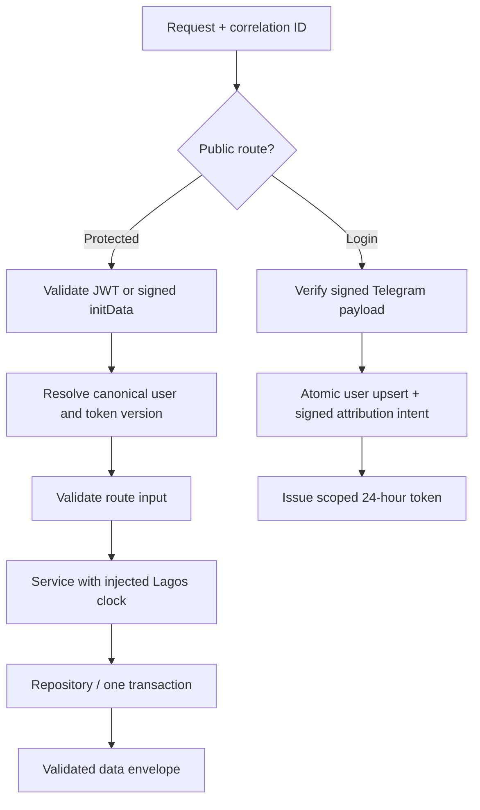

# Foundations design review — before implementation

24 October 2026. Branch feature/foundations; parent main cb5ca23. Implements delivery02 in dependency order. No live production data mutation is authorized by this document; migration code is rehearsed on isolated PostgreSQL and submitted for review first.

## Request flow and invariants

Canonical identity is users.id = tg_<telegram_id>; bare IDs are never valid business keys. Protected requests do not create accounts: an authenticated-but-unregistered caller receives401 and must use login. Login upsert owns creation and attribution intent together, so first-request middleware cannot consume the only referral-capture opportunity. Every JWT is checked against current token_version; bumping that value revokes all older sessions. Signed initData is accepted only for a registered player, with the same signature/time checks as login.

All daily decisions use the injected Africa/Lagos calendar date; match queries use an indexed lagos_date, independent of session timezone. HTTP envelopes are {data}; stable errors include error,message,requestId. Compatibility endpoints can temporarily retain existing top-level fields as additive aliases, explicitly deprecated. New frontend API functions read data only.

## Migration algorithm

1. Baseline migration reproduces the existing repository schema. Existing databases are not automatically marked baselined; schema drift inspection and a restored backup precede prisma migrate resolve. Empty databases apply baseline normally. Prisma7.10.1 is pinned; pg remains the query layer.
2. A second transactional migration takes write locks and timeouts. It rejects malformed/noncanonical users, unresolved orphan references (including matches.winner_id), conflicting idempotency responses, and streak collisions across different windows. Error messages identify table/count, not private player data.
3. Same-window streak duplicates merge: later last_login_date supplies progress; claimed flag is OR, grace usage is max. Different-window duplicates stop for manual resolution. No reward/audit entry is deleted. Bare task duplicates retain a single completion; user points are not recalculated or silently deducted. Identical idempotency duplicates collapse; conflicting cached responses abort.
4. Normalize all player references, including winner_id; add/validate FKs. Users gain token_version. Matches gain stored Lagos date and index. Record signed first-login attribution intent with an insert-once row in the same user transaction; later referral stage resolves it durably.
5. Migration failure rolls back every transformation. Prisma history makes successful deployment idempotent. Add a read-only preflight command returning counts, never data or secrets. Do not auto-run the identity migration in the existing production startup before baseline/recovery approval.

## Frontend flow

Telegram opens -> ready/expand -> POST login -> keep token in memory -> POST /login-streak -> map validated server progress for display -> render. No local Day1 initialization, cookie session restoration, milestone award or stat increments. A network failure displays error/retry; it never invents a streak. Remove old session cookie. Do not open sockets until GET /config/rules says realtime is available. This prevents reconnect spam against an unimplemented backend.

## Rate limits and errors

Redis uses atomic INCR+TTL and accurate remaining TTL. Development fallback has periodic opportunistic eviction and a hard key bound. General read availability can fall back to bounded local counters with an explicit warning; money/provider routes require shared fail-closed protection when enabled. Body size, media type, route schemas and query limits are bounded. Proxy trust is explicit configuration, not a hardcoded hop assumption. Server failures do not expose raw database/provider errors or tokens.

## Tests before acceptance

Real PostgreSQL: baseline+identity from empty DB, realistic mixed IDs, duplicate merge, winner normalization, orphan and conflicting-response rejection with rollback, cross-window conflict, FKs, invalid users and rerun history. Application: same JWT/initData identity, missing user, revoked token, signed start parameter persisted once, first-login concurrency and attribution write rollback. Clock tests cover Lagos midnight/month/year/leap transitions and DB sessions in several timezones. Frontend tests cover actual progress mapping, failed login/progress, no persisted token, no socket before capability and malformed response. Run strict TS, ESLint, all existing tests and both builds in CI.

## Deliberately later

Full match/participants/event schema, monetary ledger, entitlement engine, complete task-day qualification, reward cycle redesign, game logic, Redis matchmaking, Stars and provider integrations follow their own specs. They must not be presented as complete because these foundations pass. The current legacy eligibility query is explicitly marked transitional until stage04/11.
